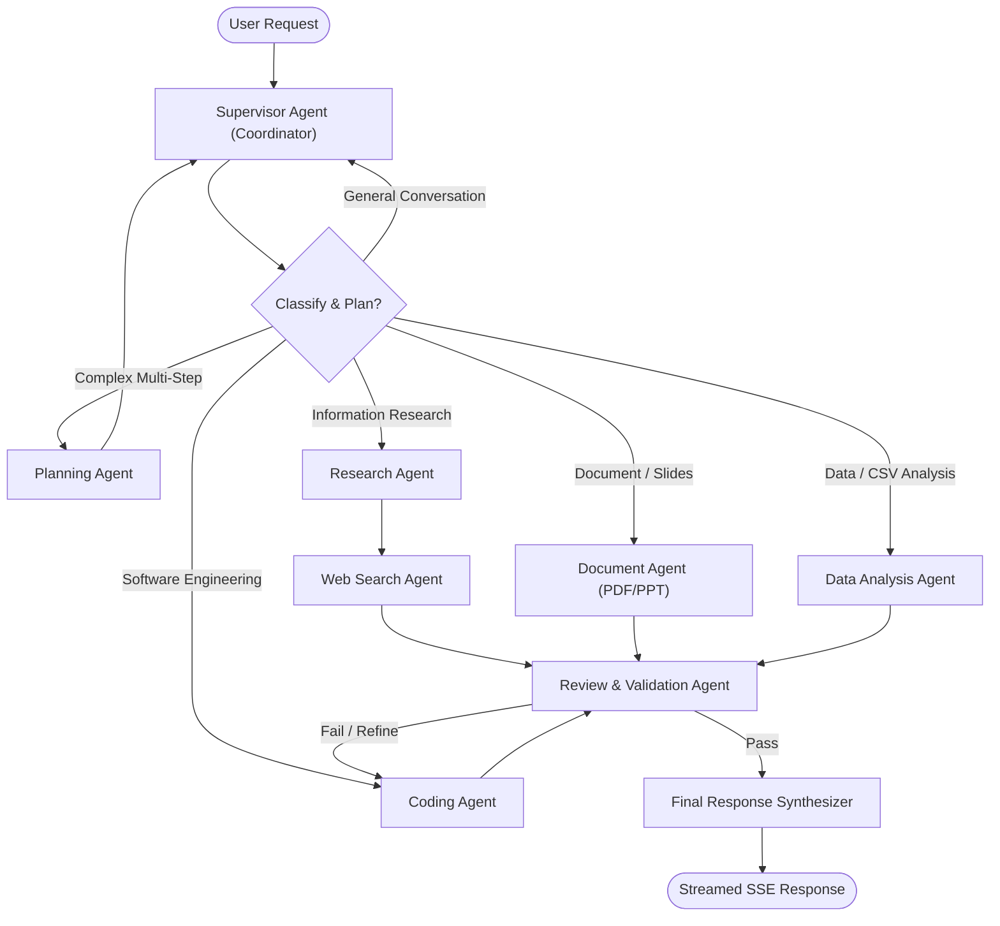

# Zen AI — Enterprise Architecture & System Design

## 1. High-Level Architectural Overview

Zen AI is an enterprise-grade multi-agent AI orchestration platform engineered for distributed reliability, sub-second streaming responsiveness, advanced retrieval-augmented generation (RAG), and secure multi-tenant execution.

```
+---------------------------------------------------------------------------------------+
|                                    CLIENT TIER                                        |
|  React 19 + Vite 8 + Tailwind 4 SPA (Claude/Linear/Perplexity UX, Monaco Studio)      |
+-------------------------------------------+-------------------------------------------+
                                            | HTTPS / SSE / WebSockets
                                            v
+---------------------------------------------------------------------------------------+
|                                    API GATEWAY                                        |
|  - TLS Termination & Helmet Security Headers       - Distributed Rate Limiting (Redis)|
|  - Correlation ID Injection (x-correlation-id)    - Session Cookie / Token Extraction |
|  - Non-blocking Stream Proxying                    - Service Discovery & Routing      |
+-------------------+-------------------+-------------------+---------------------------+
                    |                   |                   |
                    v                   v                   v
          +-----------------+ +-----------------+ +-----------------+
          |  AUTH SERVICE   | |  CHAT SERVICE   | | BILLING SERVICE |
          | - Firebase Verif| | - Thread Storage| | - Razorpay Hub  |
          | - RBAC (Admin)  | | - Folder Mgmt   | | - Webhooks      |
          | - Session Cache | | - Message Search| | - Token Quotas  |
          | - Credit Balances | - IDOR Guard   | | - Invoicing     |
          +--------+--------+ +--------+--------+ +--------+--------+
                   |                   |                   |
                   +---------+---------+---------+---------+
                             |                   |
                             v                   v
          +---------------------------------------------------------+
          |                 MULTI-AGENT AI SERVICE                  |
          | - LangGraph Multi-Agent Orchestrator (8 Agents)         |
          | - Dynamic Planner & Intent Classifier                    |
          | - Provider Abstraction Layer (Gemini, Groq, OpenRouter) |
          | - Server-Sent Events (SSE) Streaming Engine             |
          | - Code Artifact Generator & Review Pipeline             |
          +----------------------------+----------------------------+
                                       |
                   +-------------------+-------------------+
                   |                                       |
                   v                                       v
+------------------------------------+  +------------------------------------+
|       ASYNC WORKER TIER            |  |       PERSISTENT DATA TIER         |
| - BullMQ Redis Distributed Queues  |  | - MongoDB Replica Set (Core Store) |
| - Document Chunking & Parsing      |  | - Redis Cluster (Cache, Pub/Sub)   |
| - Vector Indexing & Reranking      |  | - Qdrant Vector DB (RAG Embeddings)|
| - Async Notifications & Invoices   |  | - AWS S3 / Local Storage Bucket    |
+------------------------------------+  +------------------------------------+
```

---

## 2. Core Service Boundaries & Responsibilities

### 2.1 API Gateway (`:5000` / `:8000`)
- **Reverse Proxy & Routing**: Uses low-latency reverse proxy routes without buffering payload streams.
- **Request Tracing**: Generates or forwards `x-correlation-id` for distributed end-to-end tracing.
- **Perimeter Security**: Enforces HTTP Helmet security headers, strict CORS, rate-limiting backed by Redis, and cookie extraction.
- **Authentication Check**: Validates Redis session tokens or forwards signed JWT tokens to downstream services.

### 2.2 Auth Service (`:8001`)
- **Identity Provider**: Validates Firebase ID tokens, federated social logins, and password credentials.
- **User Repository**: Manages user profiles, role-based access control (User vs. Admin), active subscriptions, and credit balances.
- **Service-to-Service Security**: Protects internal plan update and credit deduction APIs using cluster-wide HMAC signatures (`x-service-signature`).

### 2.3 Chat Service (`:8002`)
- **Thread & Message Management**: Persists conversations, message histories, file attachments, and metadata.
- **Authorization Guard**: Enforces strict tenant isolation, preventing any user from accessing another user's threads (Anti-IDOR).
- **Organization & Search**: Provides full-text conversation search, folder grouping, thread pinning, and message regeneration history.

### 2.4 Multi-Agent Service (`:8003`)
- **LangGraph Orchestrator**: Executes an intelligent state graph featuring 8 specialized agents:
  1. **Supervisor Agent**: Top-level coordinator routing tasks, managing shared workflow state, and synthesizing final answers.
  2. **Planning Agent**: Breaks complex user inquiries into structured multi-step execution plans.
  3. **Research Agent**: Conducts multi-query web investigations and information synthesis.
  4. **Web Search Agent**: Executes live queries via Tavily API with source citation extraction.
  5. **Coding Agent**: Generates production-ready code artifacts with Monaco editor integration.
  6. **Review & Validation Agent**: Evaluates generated code and content for bugs, vulnerabilities, and quality.
  7. **Document Agent**: Generates professional PDF and PowerPoint presentations.
  8. **Data Analysis Agent**: Parses tabular data, CSVs, and computes metrics with visualizations.
- **Resilient AI Provider Layer**: Implements model selection, provider fallbacks (Groq -> Gemini -> DeepSeek -> OpenRouter), exponential backoff, rate-limit recovery, and token cost telemetry.
- **Real-Time Streaming Engine**: Streams tokens, reasoning steps, tool invocations, and agent state transitions over Server-Sent Events (SSE).

### 2.5 Billing Service (`:8004`)
- **Subscription Lifecycle**: Manages Free, Pro, and Enterprise subscription plans.
- **Payment Verification**: Validates Razorpay payments with idempotent safeguards to prevent double-crediting.
- **Asynchronous Webhook Processing**: Listens for Razorpay webhook events to automatically renew subscriptions and credit quotas.
- **Invoicing & Transaction History**: Provides user transaction logs and download links for invoices.

### 2.6 Background Worker Tier (BullMQ)
- **Queues**:
  - `document-processing`: Ingestion of PDF, DOCX, TXT, CSV files.
  - `embedding-indexing`: Vectorizing chunked content into Qdrant.
  - `report-generation`: Long-running PDF/PPT report compilation.
  - `usage-aggregation`: Hourly/daily token usage rollups and analytics.

---

## 3. Data Model & Storage Strategy

### 3.1 MongoDB (Primary Document Store)
- **Users**: Account credentials, profile metadata, role (`user` | `admin`), plan (`free` | `pro` | `enterprise`), credit balance, monthly token quotas, timestamps.
- **Conversations**: User ID, title, pinned status, folder ID, model preferences, agent preferences, timestamps.
- **Messages**: Conversation ID, role (`user` | `assistant` | `system`), content, reasoning trace, artifacts array, image attachments, source citations, token count, cost.
- **KnowledgeBases & Documents**: User/workspace ID, document title, mime type, chunk count, vector collection reference, processing status (`pending` | `indexed` | `failed`).
- **Payments & Invoices**: User ID, Razorpay order/payment IDs, plan ID, credits awarded, amount, currency, status (`created` | `paid` | `failed`), timestamp.

### 3.2 Redis (In-Memory Data Tier)
- **Session Cache**: Keyed as `session:<sessionId>` with 7-day TTL.
- **Distributed Rate Limiting**: Token-bucket sliding window per user IP and agent type.
- **Idempotency Store**: Keys `idempotency:<hash>` preventing duplicate payment or generation executions.
- **BullMQ Orchestration**: Job state, queues, retry delayed sets, dead-letter queues.

### 3.3 Qdrant (Vector Database)
- **Multi-Tenant Collections**: Namespaced by `kb_<workspaceId>` or user-isolated collections.
- **Payload Metadata**: `{ docId, userId, filename, chunkIndex, pageNumber, text }`.
- **Hybrid Search**: Combines dense vector similarity (Gemini / Text-Embedding-3) with sparse payload filtering.

---

## 4. Multi-Agent LangGraph Workflow



---

## 5. Security & Isolation Architecture

1. **Service-to-Service Authentication**: Internal communication between Gateway, Auth, Agent, Chat, and Billing microservices requires a cryptographically signed header (`x-service-auth: HMAC_SHA256(timestamp + path, CLUSTER_SECRET)`).
2. **Tenant Data Isolation**: Every MongoDB query and Qdrant vector filter strictly scopes search expressions by `userId` or `workspaceId`.
3. **Isolated Sandbox Code Execution**: User-generated code preview operates strictly in client-side sandboxed iframes (`sandbox="allow-scripts"` without `allow-same-origin`) or isolated serverless runners.
4. **Resilient Rate Limiting**: Two-tiered rate limiting (global IP rate limit on Gateway + per-user per-agent quota in Redis).

---

*Document approved by Zen AI Systems Architecture Group.*
